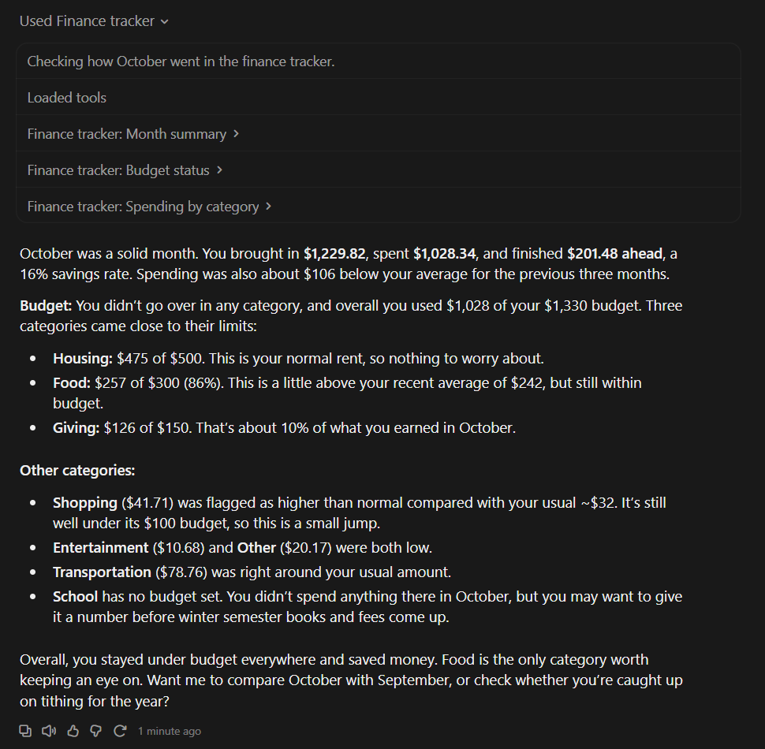
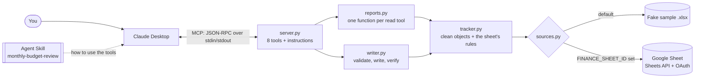

# Finance Tracker MCP Server

An **MCP server** that gives Claude budget-aware tools for my personal finance tracker in Google Sheets, plus an **Agent Skill** that combines those tools into a monthly budget review.

Ask Claude *"Was I over budget on anything in October?"* and it calls `budget_status`, gets back each category's budget, spending and status, and answers using my tracker's own rules.

> **All data in this repository is fictional.** The sample tracker, the example review, and every number in this README come from a generated fake workbook. My real spreadsheet, its ID and my Google credentials are never stored in the repo.

> 📸 **Screenshot placeholder:** Claude Desktop answering *"How did I do in October 2026?"* by calling several `finance-tracker` tools.
<!-- Take this screenshot with FINANCE_SHEET_ID removed from the Claude Desktop config, so it shows the fake sample. Save it as docs/images/claude-desktop-demo.png and replace this placeholder with:  -->

---

## Why I built it

Claude can already read Google Sheets cell by cell, but cells don't carry my rules: a **Transfer** between my own accounts isn't spending, **tithing** is 10% of income except transfers, a budget category is **"Watch"** at 80% used, and a month runs from the 1st to the 1st. A generic connector leaves Claude to rediscover that on every question, and it can get it wrong.

So I wrote those rules once in Python, tested them, and exposed them as **domain-specific tools**. Claude picks the right tool from its description, and the numbers it gets back are already correct. I built it as a portfolio project for work on MCP servers and Agent Skills, in small milestones, so I can explain every part.

## How it works



- **`server.py`** is the MCP layer. Claude Desktop starts it as a subprocess. Each tool checks its arguments and turns problems into messages Claude can act on.
- **`reports.py` / `writer.py`** do the work as plain Python with no MCP code, so they're easy to test.
- **`tracker.py`** turns raw cells into `Transaction`, `BudgetLine` and `Month` objects and implements the sheet's rules (budget status, tithing, transfers, 3-month averages).
- **`sources.py`** fetches raw cells from either the fake sample or the real sheet. Both go through the same code, so they can't disagree.

## The tools

| Tool | Answers | Changes data? |
|---|---|---|
| `month_summary` | "How did I do in October?" Income, spending, net, savings rate | No |
| `budget_status` | "Am I over budget on anything?" Budget vs. actual, OVER / Watch / On track | No |
| `spending_by_category` | "Where did my money go?" Per category, vs. its 3-month average | No |
| `compare_months` | "Am I spending more than last month?" Change per category | No |
| `biggest_expenses` | "What were my biggest purchases?" | No |
| `recent_transactions` | "Show my last 5 Food purchases." Filters by type, category, account | No |
| `tithing_status` | "Am I caught up on tithing?" Owed, paid, unpaid entries | No |
| `add_transaction` | "Add a $12 Food expense from today." | **Adds one row** |

Each tool's docstring says *when* to use it, because that text is how Claude chooses a tool. The read tools are annotated `readOnlyHint`, and `add_transaction` is marked as a write that never deletes or overwrites.

## The Agent Skill

[`skills/monthly-budget-review/SKILL.md`](skills/monthly-budget-review/SKILL.md) turns the tools into a repeatable workflow. **The server provides capabilities; the skill provides judgment.** It tells Claude which month to review, to call all six read tools, how to read the results without being fooled, and the exact report format.

The "how to read the results" part came from testing on real data:
- A category with **no budget set** isn't "over budget."
- An "unusually high" flag on a **fixed bill** is usually a false alarm.
- A **month-to-date** review has to account for how much of the month has passed.
- Every number must come from a tool result.

See the skill's output on sample data: **[docs/example-budget-review.md](docs/example-budget-review.md)**. The skill also ships with three test cases in `evals/`, for example "reviews a month but doesn't add a transaction the user only mentioned."

## Design decisions

- **Safe by default.** With no settings it uses the fake sample. The read tools use a **read-only** Google sign-in. Writing to the real sheet needs **two deliberate steps**: `FINANCE_ALLOW_REAL_WRITES=yes` and a separate read-write sign-in.
- **Guards on the one write tool.** It validates category, amount, date and account. It rejects text starting with `=`, `+`, `-` or `@`, which blocks **spreadsheet formula injection**, since an AI might pass along text from a receipt or email. It refuses exact **duplicates**, in case an agent retries. It **reads the row back** to confirm the write.
- **Errors that help the agent recover.** For example, *"Unknown category 'Groceries'. Valid category names: …Food…"* lets Claude fix the call itself.
- **Correct money.** Amounts are `Decimal`, not `float`, so totals never drift by a cent. The sheet's rules are reimplemented in Python and tested, never read from formula results.
- **Privacy.** Credentials live outside the repo, and `.gitignore` blocks them as a backup. The repo's tool for checking the real sheet (`check_connection`) asks Google only for tab names and sizes, never cell values.
- **Testable.** "Today" and random seeds are parameters, so tests never depend on the date. Tests use a fake Google service, with no network involved.

## Quick start (fake data, about 2 minutes)

Requires Python 3.10+. These commands are for Windows PowerShell; on macOS/Linux use `.venv/bin/python`.

```powershell
git clone https://github.com/wpixton/MCP-server.git
cd MCP-server
python -m venv .venv
.\.venv\Scripts\python.exe -m pip install -e ".[dev]"

.\.venv\Scripts\python.exe -m pytest                                   # 142 tests
.\.venv\Scripts\python.exe -m finance_tracker.demo                     # list the tools as Claude sees them
.\.venv\Scripts\python.exe -m finance_tracker.demo budget_status month=2026-10
```

`demo` starts the server over stdio, the same way Claude Desktop does, and prints the tool's result. To make the sample's "this month" match today's date, regenerate it with `python -m finance_tracker.sample_tracker`.

**Next steps:**
- **Use it in Claude Desktop:** [docs/claude-desktop.md](docs/claude-desktop.md)
- **Point it at a real Google Sheet:** [docs/google-setup.md](docs/google-setup.md)

## Example prompts

- "How did I do in October 2026?"
- "Was I over budget on anything last month?"
- "Where did my money go this month, and is anything higher than normal?"
- "How does October compare to September?"
- "What were my 5 biggest expenses in October?"
- "Show my last 5 Food purchases."
- "Am I caught up on tithing this year?"
- "Can you do my monthly budget review?" (uses the Agent Skill)
- "Add a $5 Food expense for coffee today." (refused for the real sheet unless writes are switched on)

## Project layout

```
finance_tracker/
  server.py            MCP server: 8 tools, their descriptions, server instructions
  reports.py           what each read tool returns (plain dicts, no MCP)
  writer.py            add_transaction: validate, find the empty row, write, verify
  tracker.py           cells -> Transaction / BudgetLine / Month, plus the budget rules
  sources.py           read/write raw cells: fake .xlsx or Google Sheets
  layout.py            single source of truth for tabs, header rows, columns
  config.py            settings from environment variables
  google_sheets.py     OAuth sign-in (separate read-only and read-write tokens)
  check_connection.py  one-time sign-in; prints only tab names and sizes
  sample_tracker.py    generates the fake tracker
  demo.py              call any tool from a terminal
skills/monthly-budget-review/   the Agent Skill and its test cases
sample_data/                    the generated fake tracker
docs/                           setup guides and the example review
tests/                          142 pytest tests
```

## Testing

`pytest` runs 142 tests in a few seconds, without a network or any real data. They cover:
- parsing Google-style cell values
- every budget and tithing rule
- a round trip between the generator and the reader
- each tool through a real MCP client, plus one that starts the server as a **separate process over stdio**, like Claude Desktop does
- every `add_transaction` refusal, each confirming the file is unchanged
- both locks on real-sheet writes

## Known limitations

- **"Unusually high" is a simple rule:** above 1.25× the previous 3-month average. It produces false alarms for a fixed bill that started partway through that window. The Agent Skill tells Claude to discount those, but a better rule would ignore categories that match last month.
- **Fresh data on every call.** Each tool reads the sheet again, which is always current but means one Google API request per call. There's no cache.
- **Not covered by the tools:** account balances, net worth, and recurring bills.
- **`add_transaction` only adds rows.** Edits and deletes are left to the user in the sheet, on purpose.
- **Sign-in expiry:** a Google Cloud app left in "Testing" mode with an External audience requires signing in again every 7 days.

## Built with

Python · [MCP Python SDK](https://github.com/modelcontextprotocol/python-sdk) 2.x (`MCPServer`) · Google Sheets API · openpyxl · pytest

Developed with Claude Code as a pair programmer, one milestone at a time. An earlier version of the project (an Excel key-checkout log) is preserved on the [`key-log`](https://github.com/wpixton/MCP-server/tree/key-log) branch.
